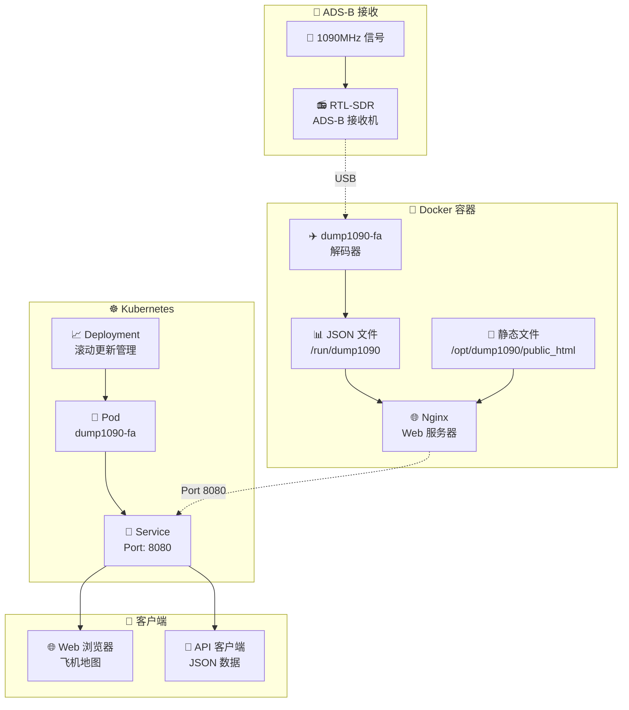
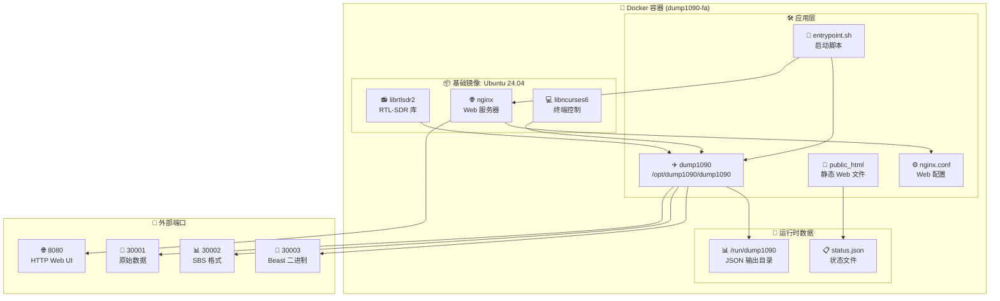
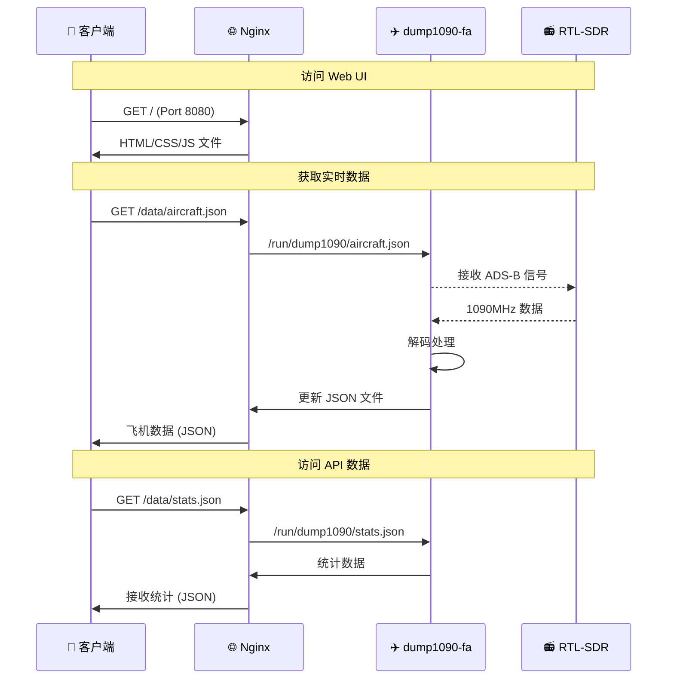
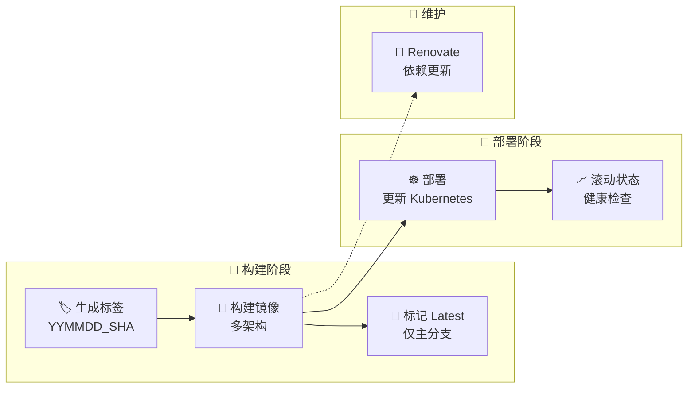

# ✈️ dump1090-fa Docker

支持 Kubernetes 的 dump1090-fa 容器化项目

[](https://gitlab.green-rabbit.net/kimata/dump1090-fa/-/pipelines)

## 📑 目录

- [📋 概述](#-概述)
  - [主要特性](#主要特性)
- [🏗️ 系统架构](#️-系统架构)
  - [架构概览](#架构概览)
  - [容器结构](#容器结构)
  - [网络结构](#网络结构)
- [🚀 安装部署](#-安装部署)
  - [环境要求](#环境要求)
  - [1. 克隆仓库](#1-克隆仓库)
  - [2. 构建 Docker 镜像](#2-构建-docker-镜像)
- [💻 运行方式](#-运行方式)
  - [使用 Docker Compose 运行](#使用-docker-compose-运行)
  - [使用 Kubernetes 运行](#使用-kubernetes-运行)
- [🔧 配置](#-配置)
  - [Nginx 配置](#nginx-配置)
  - [dump1090-fa 配置](#dump1090-fa-配置)
- [📊 CI/CD](#-cicd)
  - [GitLab CI 流水线](#gitlab-ci-流水线)
  - [自动部署](#自动部署)
- [🌐 端口说明](#-端口说明)
- [📝 许可证](#-许可证)

## 📋 概述

本项目将 [dump1090-fa](https://github.com/flightaware/dump1090) 容器化，使其能够在 Kubernetes 环境中运行。它接收 ADS-B 信号、解码飞机位置信息，并通过 Web 界面进行展示。

### 主要特性

- 📦 **容器化** - 通过 Docker 实现环境标准化
- ☸️ **支持 Kubernetes** - 可在集群环境中运行
- 🌐 **Web 界面** - 由 Nginx 提供 HTTP 服务
- 🛡️ **多架构支持** - 支持 AMD64/ARM64
- 🔄 **自动部署** - 通过 GitLab CI/CD 持续交付
- 📊 **JSON API** - 以 JSON 格式提供实时数据

## 🏗️ 系统架构

### 架构概览



### 容器结构



### 网络结构



## 🚀 安装部署

### 环境要求

- 🐳 Docker 20.10+
- ☸️ Kubernetes 1.20+（集群运行时）
- 📻 支持 RTL-SDR 的 USB 接收机
- 🖥️ Linux 环境（推荐：Ubuntu/Debian）

### 1. 克隆仓库

```bash
git clone https://github.com/muzihuaner/dump1090-fa.git
cd dump1090-fa
```

### 2. 构建 Docker 镜像

```bash
# 多架构构建
docker buildx build --platform linux/amd64,linux/arm64/v8 -t dump1090-fa .

# 单架构构建
docker build -t dump1090-fa .
```

## 💻 运行方式

```

### 使用 Docker Compose 运行

编辑 `docker-compose.yml`，填入接收机的经纬度：

```yaml
environment:
  RECEIVER_LON: "your longitude"
  RECEIVER_LAT: "your latitude"
  RECEIVER: "rtlsdr"
```

然后构建并启动：

```bash
docker compose up -d --build
```

# 访问 Web UI
open http://localhost:8080

### 使用 Kubernetes 运行

```bash
# Kubernetes 部署
kubectl apply -f - <<EOF
apiVersion: apps/v1
kind: Deployment
metadata:
  name: dump1090-fa
  namespace: sensor
spec:
  replicas: 1
  selector:
    matchLabels:
      app: dump1090-fa
  template:
    metadata:
      labels:
        app: dump1090-fa
    spec:
      containers:
      - name: dump1090-fa
        image: registry.example.com/dump1090-fa:latest
        ports:
        - containerPort: 8080
        - containerPort: 30001
        - containerPort: 30002
        - containerPort: 30003
---
apiVersion: v1
kind: Service
metadata:
  name: dump1090-fa-service
  namespace: sensor
spec:
  selector:
    app: dump1090-fa
  ports:
  - name: http
    port: 8080
    targetPort: 8080
  - name: raw
    port: 30001
    targetPort: 30001
  - name: sbs
    port: 30002
    targetPort: 30002
  - name: beast
    port: 30003
    targetPort: 30003
EOF
```

## 🔧 配置

### Nginx 配置

通过 `nginx.conf` 控制 Web 服务器的行为：

- 🌐 **HTTP 服务器**：监听端口 8080
- 📊 **数据端点**：通过 `/data` 提供 JSON 文件
- 📄 **静态文件**：通过 `/` 提供 Web UI

### dump1090-fa 配置

通过 `entrypoint.sh` 控制 dump1090-fa 的行为：

- 📊 **统计输出**：每 60 秒更新一次统计信息
- 🌐 **网络功能**：启用
- 📁 **JSON 输出**：输出到 `/run/dump1090` 目录
- 📻 **设备选择**：通过环境变量 `DEVICE_SERIAL` 指定 RTL-SDR 序列号；未设置时自动使用第一个可用设备
- 📍 **接收机位置**：通过 `RECEIVER_LAT` / `RECEIVER_LON` 设置接收机经纬度
- 📡 **接收机类型**：通过 `RECEIVER` 指定，当前仅支持 `rtlsdr`

## 📊 CI/CD

### GitLab CI 流水线



### 自动部署

- 🎯 **触发条件**：向 main 分支推送
- 🏷️ **标签生成**：`YYMMDD_CommitSHA` 格式
- 🏗️ **多架构构建**：AMD64/ARM64
- ☸️ **Kubernetes 部署**：sensor 命名空间
- ✅ **健康检查**：确认 rollout status

## 🌐 端口说明

| 端口 | 协议 | 用途 | 说明 |
|--------|------------|------|------|
| 🌐 **8080** | HTTP | Web UI | 在浏览器中显示地图 |
| 📡 **30001** | TCP | 原始数据 | 输出原始 ADS-B 数据 |
| 📊 **30002** | TCP | SBS 格式 | SBS1 BaseStation 格式 |
| 🔗 **30003** | TCP | Beast 二进制 | Mode-S Beast 二进制格式 |

## 📝 许可证

本项目的容器化部分基于 Apache License Version 2.0 发布。

dump1090-fa 本体遵循 [FlightAware](https://github.com/flightaware/dump1090) 的 GPL 许可证。

---

